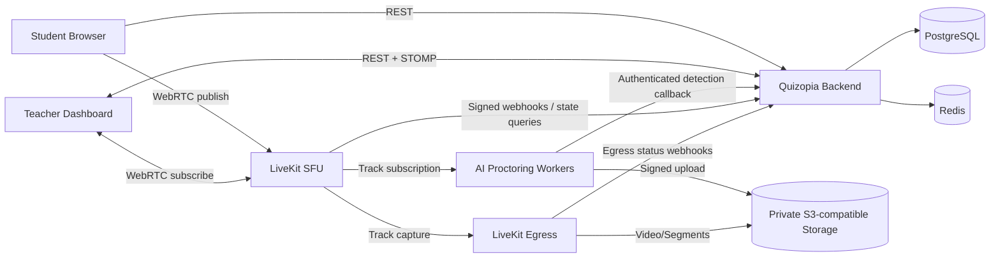

# ADR-008 — Phase 4 Hybrid Exam Monitoring, Activity Tracking & AI Proctoring

- **Status:** Accepted architecture, **academic demonstration profile v1.1** (2026-11-14). Model performance and code validation remain unverified.
- **Owners:** Quizopia Product Owner / Technical Lead; Backend, Frontend, Media and AI reviewers.
- **Scope:** P4-0 through P4-F. This ADR is delivered as an offline artifact for placement in Backend; **not committed to GitHub**. GitHub tracking Issues may be published separately without implementing code.
- **Source baseline:** System `86cdb2e`, Backend `972d6a9`, Frontend `7a01090` (`main`, checked 2026-11-13).
- **Related (once the owner commits the supplied docs):** [Technical Design](https://github.com/hhtuann/Quizopia_System/blob/main/docs/phase4/TECHNICAL_DESIGN.md), [API & Events](https://github.com/hhtuann/Quizopia_System/blob/main/docs/phase4/API_EVENT_CONTRACTS.md).

## 1. Context

Quizopia uses Spring Boot / PostgreSQL / Redis / STOMP, Next.js, and a modular-monolith deployment with Docker Compose. The existing `AttemptService.startAttempt` holds a pessimistic **session** lock; `AttemptAutosaveService` holds the **attempt** lock and uses a strictly-increasing sequence-number SQL UPSERT. `LiveMonitor` receives ephemeral `ATTEMPT_STARTED`, `ATTEMPT_SUBMITTED`, `ACTIVE_COUNT_CHANGED`, and session lifecycle updates. Current `StompSubscribeInterceptor` is an allowlist. There is no camera transport or AI monitoring in the inspected source. MinIO already exists in dev Compose; Flyway reaches V32. All these are source observations, not live load-test results.

Sources:
- https://github.com/hhtuann/Quizopia_Backend/blob/972d6a9/src/main/java/com/quizopia/backend/attempt/application/AttemptAutosaveService.java
- https://github.com/hhtuann/Quizopia_Backend/blob/972d6a9/src/main/java/com/quizopia/backend/attempt/application/AttemptService.java
- https://github.com/hhtuann/Quizopia_Backend/blob/972d6a9/src/main/java/com/quizopia/backend/realtime/authorization/StompSubscribeInterceptor.java
- https://github.com/hhtuann/Quizopia_Frontend/blob/7a01090/components/teacher/LiveMonitor.tsx
- https://github.com/hhtuann/Quizopia_System/blob/86cdb2e/docker-compose.yml

## 2. Ten accepted product decisions

| # | Decision | Status |
|---|---|---|
| D1 | Monitoring ON **always** requires camera; restricted to eligible `CLASS_RESTRICTED` Sessions with ≥1 active assigned class; never `PUBLIC`. | Accepted |
| D2 | LiveKit **self-hosted first**. | Accepted |
| D3 | **One room per Exam Session**; room identifiers are opaque. | Accepted |
| D4 | Full video recording is teacher-configurable, **OFF by default**. | Accepted |
| D5 | Evidence clips can be extracted from full recording **or from a bounded rolling buffer**. | Accepted |
| D6 | Reuse **MinIO in development**; use **S3-compatible storage in production**. | Accepted |
| D7 | **30 days** for recordings/clips/snapshot evidence; **90 days** for activity metadata. Future production/legal holds require a separate decision. | Accepted |
| D8 | Camera loss after Attempt start → **record incident, reconnect, continue Attempt**, without automatic punishment or submission. | Accepted |
| D9 | Independent **AI Proctoring Service** with model adapters. | Accepted |
| D10 | Separate AI repository, added to `Quizopia_System` as a **git submodule when implementation is authorized**. | Accepted; repository not yet created |

## 3. Architectural decision

Keep Spring Boot as the sole owner of identity, enrollment, authorization, Attempt lifecycle, submitted answers, grading, monitoring policy, alert adjudication, and metadata. Introduce LiveKit SFU + separately operated Egress/recording components; introduce AI Worker(s) reading selected media tracks; keep object blobs in private S3-compatible storage. Frontend uses REST + STOMP for control/metadata and WebRTC for camera media. **Never send raw media frames through Spring Boot or STOMP.** AI and Egress services have no write permission to Attempt/Grade tables. Service ingress is authenticated and idempotent. Retain STOMP simple broker for initial scale; propose broker/outbox evolution only after measurement.

## 4. Important invariants / hard boundaries

1. `PUBLIC` Session can never enable Monitoring, regardless of UI or payload tampering. A `CLASS_RESTRICTED` monitored Session must retain ≥1 active teacher-owned class; removal of last class is denied.
2. `requireCamera=true` is a **derived enforced property** of `monitoringEnabled=true`, not a client preference. No silent camera waiver on a monitored Session; accommodations use an explicitly authorized alternative assessment path or separate non-monitored Session with equitable policy.
3. Configuration changes stop at first of: scheduled `startsAt`, a Session OPEN state, or first ever Attempt. For SCHEDULED Sessions, freeze even if lazy-open has not run. Use server clock, row lock, expected version/concurrency strategy, and an immutable effective policy snapshot.
4. Camera readiness is **verified by Backend using LiveKit room/track state**, not by frontend claims. One-time, short-lived readiness lease is bound to user/session/media participant and consumed atomically only for **new** monitored Attempts. Already-started Attempts may resume while camera reconnects, consistent with D8.
5. Media identity exists before Attempt ID; create explicit media-session-to-attempt binding on successful start. Never infer Attempt from user, most recent attempt, or an untrusted AI callback. Pre-attempt footage must be expired/deleted if an Attempt is never started.
6. Existing `startAttempt` lock ordering (session → attempt) and autosave/submit locking (attempt only) must stay unchanged. Do not hold DB locks while waiting on LiveKit, AI, Egress, or S3 network calls.
7. Accepted answer history is written **in the same database transaction after successful UPSERT** and never on `STALE_SEQUENCE`. Unique `(attempt_id, attempt_question_id, accepted_sequence)`. If history persistence fails, the autosave write rolls back. Avoid storing essay content per keypress; separate retention/content policy required.
8. Browser-side events are observations, not verified misconduct. Server-acknowledged events distinguish trust/source; retain both client and server time plus late/clock-skew metadata.
9. Raw detections and aggregated alerts are distinct. Confidence is model-specific, thresholds are versioned, with temporal smoothing, cooldown and dedupe. AI cannot mark a student as cheating or change score.
10. Full recording OFF does not imply "no storage" when evidence clips ON: rolling buffering itself stores temporary video and must be expressly disclosed and automatically cleaned.
11. Recording `STARTING`/`RECORDING` never means final video persisted. Only after confirmed finalized object/segments + checks does it become `AVAILABLE`; gaps / errors are explicit.
12. Evidence metadata may outlive objects (90d activity vs 30d evidence); return `EXPIRED` instead of broken URLs. Every access is authorized, audited, and time-scoped.
13. One-room-per-session teacher joins only with teacher owner + DB-backed permission; student can publish camera only (`canSubscribe=false`, audio/screen sharing disabled); worker/egress service credentials never reach browsers.
14. Self-hosted LiveKit **cannot immediately invalidate previously issued tokens on RemoveParticipant** in the same way as Cloud. Use minimal token TTL, reject renewals, remove/kick, revoke at application layer, record the residual exposure window, and test it. If instantaneous hard revocation is mandatory, revisit deployment/proxy/isolation; do not claim token invalidation is absolute.
15. Existing STOMP allowlist and envelopes must not be weakened. Introduce an explicitly authorized monitoring destination with versioned event schema or carefully extend compatibility, with reconnection recovery via REST/persistent cursor.
16. Even in an academic demo, keep media private, access-controlled and deleted at the configured horizon. Use **consenting adult volunteers or pre-recorded/synthetic demo footage**; do not present a classroom demo as a real-student deployment. Formal production legal/compliance approval is **out of scope for this academic demo**, not a P4 completion blocker.

## 5. Why this approach / alternatives rejected

- **Embedding AI in Spring Boot JVM:** rejected: model-runtime coupling, GPU lifecycle and performance isolation conflict with API latency and exam correctness.
- **Sending image frames over REST/STOMP:** rejected: excessive transport overhead, wrong backpressure and unauthorized subscription risks.
- **One room per Attempt:** deferred: improves isolation but complicates large teacher grids, room orchestration and recording coordination. Reconsider if strictly scoped per-track revocation proves inadequate.
- **LiveKit Cloud first:** not chosen: preferred initial self-host operational control; reassess after cost/compliance/reliability measurements.
- **Persistent live video in PostgreSQL:** rejected: store only relational metadata; private object storage holds blobs.
- **Kafka/Kubernetes/Elasticsearch now:** rejected: no measured requirement; consider only with benchmark evidence.
- **Treating AI prediction as proctoring verdict:** rejected: no automatic discipline; teacher review with audit trail.

## 6. Operational implications

Self-host LiveKit requires public endpoint, TLS, correctly exposed UDP/ICE or TURN ports, Redis as needed, and a separately deployed Egress component. Browser needs secure context (`https://` or localhost for camera permission), and TURN/fallback must be tested on student networks. Media streams, individual Egress, rolling buffering and GPU inference are independently costly: benchmark 10, 30, 50 and 100 publishers, including teacher/AI/recorder egress bandwidth. MinIO root credentials currently present in development Compose are **not** a viable production secret strategy.

Docs: https://docs.livekit.io/transport/self-hosting/deployment/ ; https://docs.livekit.io/transport/self-hosting/ports-firewall/ ; https://docs.livekit.io/transport/media/ingress-egress/egress/ ; https://docs.livekit.io/frontends/reference/tokens-grants/ .

## 7. Academic demonstration scope, privacy baseline and deferred production concerns

**The intended deliverable is a course project demonstration, not proctoring real students.** Prioritize a reproducible end-to-end demo with **5–10 simultaneous actual webcams** and the owner's **real** phone/multiple-person AI model. A deterministic synthetic-video/fake-camera path is useful for repeatable CI tests, but **stub AI does not satisfy the final real-model acceptance gate**. Preserve the full functional scope: live camera, activity/answer history, snapshots, full recording ON/OFF, clips (including bounded rolling buffer when OFF), unified timeline, review and reports. Gaze detection is an extension only after model validation.

**Baseline safeguards (still required):** show a short notice before camera use; obtain voluntary agreement from consenting adult participants; never record audio by default; keep live camera permissions owner-scoped; use private storage and short signed access; avoid logging raw media/secrets; maintain media 30d / activity 90d cleanup with earlier manual deletion of demo material; no automatic cheating verdicts. Use synthetic or approved volunteer video for AI evaluation. Demo recordings should not be shared publicly without permission.

**Deferred if ever moving beyond class demonstration:** legal impact assessments, minors/real-student workflows, cross-border data transfer reviews, full data-subject processes, provider availability contracts, production-scale audits and production launch approval. The academic demo's completion **must not be blocked** by formal production legal sign-off. Do not claim deployment with actual students is covered by this ADR.

## 8. Pending verification / not yet approved as engineering fact

- AI repository/model artifacts, format, FPS, latency, available detections, precision/recall/false-positive performance and GPU requirements.
- Which recording output (single MP4 vs segmented HLS) and Egress behavior deliver acceptable start assurance, reconnect and clip extraction under load.
- Exact S3 hosting geography/vendor, HLS playback authorization method, storage encryption options.
- Teacher permissions beyond current owner-only access, if future co-proctor roles are desired.
- For any future real-student deployment: legal review and stronger privacy governance; out of scope for academic demo.
- For course demo: test **5 actual camera publishers minimum**, target **10**; 30/50/100 are optional scale experiments, not acceptance blockers. Record hardware, bandwidth and actual results.

**Decision gate:** design accepted, **not** authorization to create AI repository, commit code, merge PRs or deploy. Implementation issues remain drafts until explicitly published/approved by owner.

## 9. Consequences and follow-up

Track P4-0..F implementation issues on GitHub; complete AI audit before committing to real inference budgets or thresholds. Preserve source invariants through Testcontainers and browser E2E. No unresolved P0/P1/P2 **functional correctness or security blockers** permitted at milestone merge gate. Revisit ADR if (a) self-host token risks block even local demo, (b) real model cannot process 5 camera feeds, (c) participant safety/notice needs change, or (d) demo benchmarks show architectural constraints.

## 10. Academic demo acceptance (2026-11-14 clarification)

- Mandatory real demo: 1 teacher, **at least 5 camera-publishing participants** (target 10), class-restricted monitored Session, authorized camera grid, answer changes + browser tab events, real phone/multiple-person AI detections, snapshot and video/clip evidence, teacher review, timeline and report. If insufficient physical cameras, use documented *real model processing* against labeled webcam/video feeds; distinguish camera simulation from real webcams.
- Full recording **OFF by default** and demonstrably ON when teacher enables it. Demonstrate clip generation when full recording is OFF through a **real bounded rolling buffer**, not a mocked previously recorded video.
- Minimum safety baseline remains: owner-only media, no public evidence, 30/90 retention, no audio by default, no AI verdict.
- **P4-F renamed to Demo Reliability & Integration Testing.** A measured 5-publisher run + failure/recovery proof are required; 10 publishers are an explicit stretch target. 30/50/100 camera scaling, production rollout, enterprise HA and formal legal compliance are *stretch/future work*.
- GitHub Issues creation only authorizes **tracking**. AI repository/submodule creation, implementation commits, merges and deployment remain separately gated.
